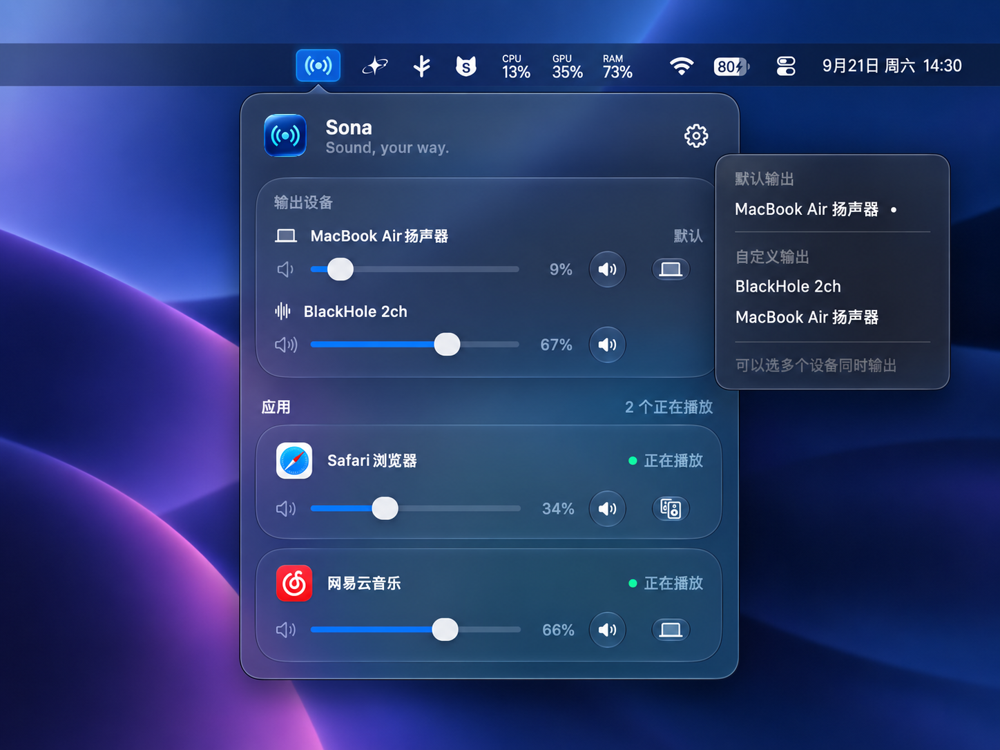

# Sona

[中文文档](README.zh-CN.md)

A macOS menu bar audio control tool: adjust volume per application and route each app to one or more output devices.



**This is a preview release.** The website offers a `.pkg` installer (not yet notarized — you will need to allow it once in Privacy & Security on first launch), or you can build from source. The app requires macOS 26 or later and currently targets Apple Silicon. See [Compatibility & Test Records](docs/COMPATIBILITY.md) for the verified scope.

## Features

- Per-application volume and mute.
- Route different apps to different outputs, or send one app to multiple devices at once.
- Independent volume control for each output device; keyboard volume keys control the selected default output.
- Shows which apps are currently playing sound, and remembers per-app volume and routing.
- Optionally switches the default output automatically when a new device (headphones, USB, Bluetooth) is connected.

Sona processes audio through a HAL virtual output device and a standalone audio service. It does not use Process Tap and does not request system recording or microphone permissions. Sona itself never reads the microphone; other apps' recording indicators are not controlled by Sona.

## Building

Requires macOS 26+, Apple Silicon, Xcode command line tools (or Xcode) with the macOS 26 SDK, and `python3`. The app's minimum system version is declared by the Swift package and Info.plist; the driver/service's macOS 14 build target does not mean the full product supports macOS 14.

From the repository root:

```sh
make test-all       # unit tests (including the app) and the final driver HAL boundary check
make                # build the driver, service, and app
```

The app is at `App/build/Sona.app`. Builds currently use local ad-hoc signing; there is no formally signed, notarized installer yet. The driver and service include arm64/x86_64 by default, but the app currently builds arm64 only; Intel is not within the verified support scope of the full application.

## Installation & Usage

### With the installer (recommended)

Download `Sona-<version>.pkg` from the website (`make release` builds it, see below). The installer is not yet notarized by Apple, so macOS will block it on first launch: click "Done", go to System Settings → Privacy & Security, click "Open Anyway" at the bottom and enter your password; or install directly from the terminal:

```sh
sudo installer -pkg ~/Downloads/Sona-0.6.0.pkg -target /
```

The installer places `/Applications/Sona.app`, `/Library/Audio/Plug-Ins/HAL/SonaDriver.driver`, `/Library/PrivilegedHelperTools/SonaAudioService` and the corresponding LaunchDaemon, then starts the service, restarts coreaudiod (playing audio pauses for a second or two) and opens Sona. To upgrade, simply install the newer version.

### From source

Installation writes to system directories and restarts coreaudiod; playing audio will be briefly interrupted. Build first, then install in order:

```sh
sudo make install-service
sudo make install-driver
make run
```

### Getting started

1. Open Sona in the menu bar and select the default physical output device.
2. Turn on the main switch; the system default output switches to Sona.
3. Play some audio, then adjust an app's volume in the list or route it to one or more outputs.
4. When Sona quits normally, it attempts to switch the system output back to the selected default device.

The service runs independently via launchd. Settings are stored in the app's UserDefaults and in the service's `/Library/Application Support/Sona/service-state.plist`. If the service is unavailable, audio may be muted; you can restore playback by selecting a physical output in System Settings → Sound.

## Uninstall

First choose "Quit Sona" from the Sona menu so it switches the system output back to a physical device. If you installed with the pkg:

```sh
sudo "/Library/Application Support/Sona/uninstall.sh"          # keep settings
sudo "/Library/Application Support/Sona/uninstall.sh" --purge  # remove settings too
```

If you installed from source:

```sh
sudo make uninstall-driver
sudo make uninstall-service
```

If you ever ran `make install-app`, also delete Sona from Applications. The `make uninstall-*` targets keep preferences and service state for easy reinstallation.

## Building the installer

```sh
make release        # build/release/Sona-<version>.pkg and .sha256, copied to website/public/downloads
```

The version number comes from `App/Info.plist`; the script verifies that `Driver/Info.plist` and `Shared/SonaProtocol.h` agree. Without certificates everything is ad-hoc signed and the installer is unsigned. With an Apple Developer Program membership, set `SONA_APP_IDENTITY`, `SONA_INSTALLER_IDENTITY` and `SONA_NOTARY_PROFILE` (created via `xcrun notarytool store-credentials`) and run the same command to get a Developer ID signed and notarized installer; the website copy automatically drops the "Open Anyway" step. See `Installer/build-installer.sh` for details.

## Limitations & verified scope

- Only apps routed to Sona are processed; apps that select a specific physical device themselves (e.g. DAWs) are not taken over.
- Output only; no per-application microphone routing.
- Multi-device output includes buffering, resampling and clock correction; sample-accurate sync between devices is not guaranteed.
- Passthrough is possible when the default output shares the sample rate and clock; multi-app mixing and digital volume still alter samples.
- Sleep/wake, Bluetooth/USB hot-plug, multi-hour playback, fast user switching and end-to-end latency still need full on-device verification.

See [Compatibility & Test Records](docs/COMPATIBILITY.md) for detailed status, test methods and results.

## Architecture & development

```text
Apps → Sona HAL virtual device → per-client shared memory → Sona Audio Service → physical outputs
                    ↑ control properties                    gain / routing / mixing / resampling
               menu bar app
```

| Directory | Responsibility |
| --- | --- |
| `App/Sources/Sona/` | SwiftUI menu bar UI, system output and control properties |
| `Driver/` | AudioServerPlugIn objects, client PCM transport, virtual clock |
| `Service/` | Physical devices, per-app gain, routing, mixing, resampling, persistence |
| `Shared/` | Control properties and shared-memory protocol |
| `Installer/` | pkg installer: Distribution, install/uninstall scripts, `build-installer.sh` |
| `website/` | Website (React + Vite); `public/downloads/` holds the current installer; deployed to Vercel |
| `Tools/` | `sonactl` and the driver boundary check |

The driver must not call Core Audio client HAL APIs; `make check-driver-boundary` checks the final binary, and driver installation also requires this check to pass.

- [Architecture spec & migration records](ARCHITECTURE.md)
- [Changelog](CHANGELOG.md)
- [Contributing guide](CONTRIBUTING.md)
- [Historical implementation & regression steps](docs/DEVELOPMENT-NOTES.md)
- [Provenance & release checks](docs/RELEASE-CHECKLIST.md)

Diagnostic logs:

```sh
log show --last 2m --predicate 'subsystem == "com.sona.driver" OR subsystem == "com.sona.audio-service"'
```

`make loopback-tools` builds the diagnostic tools; run `Tools/build/sonactl service` afterwards to read service state. Check logs for personal information such as app names and device identifiers before sharing them.

## License

Copyright © 2026 Haoyang Jin.

Sona is licensed under the [Functional Source License, Version 1.1, ALv2 Future License](LICENSE) (FSL-1.1-ALv2); the full text is in [`LICENSE`](LICENSE) at the repository root. You may freely run, study, modify and redistribute the software, including for personal use, internal use, and non-commercial education and research. The only restriction is **Competing Use**: you may not make the software (or derivatives of it) available to others in a commercial product or service that substitutes for Sona or offers substantially similar functionality. Two years after each version is published, that version converts to the [Apache License 2.0](https://www.apache.org/licenses/LICENSE-2.0).

The `.pkg` files in `website/public/downloads/` are build artifacts of `make release`, built from this repository's source. Official signed and notarized installers are sold as a one-time purchase on the website. Third-party dependencies and macOS system frameworks are governed by their own licenses.
