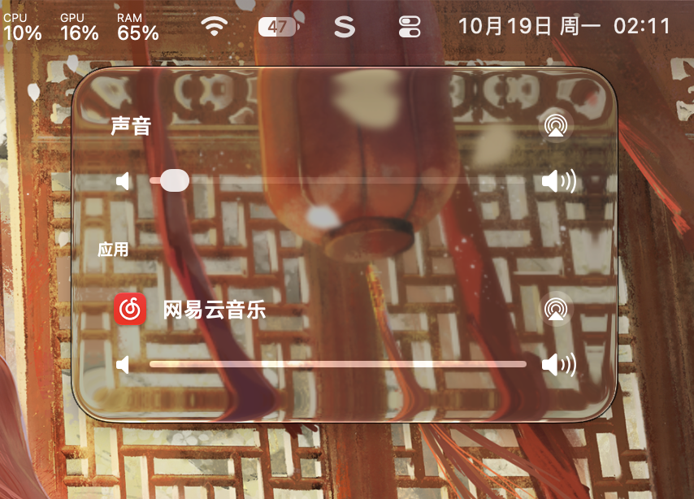

# Sona

**Sound, your way.**

在 macOS 菜单栏，独立控制每个应用的音量与音频输出。

[English](README.md) · [构建与安装](docs/BUILDING.md) · [更新记录](CHANGELOG.md)



实际应用截图，由项目作者提供。

## 功能

- **应用音量**：独立调节正在播放的应用，音量归零即可静音。
- **输出选择**：跟随默认输出、为应用指定设备，或同时输出到多个设备。
- **设备控制**：在同一面板调节输出音量、切换默认设备。
- **记住偏好**：保留应用音量与输出选择，可选登录启动和新设备接入时自动切换。

Sona 通过虚拟音频输出与独立音频服务处理声音，不申请麦克风或系统录音权限。

## 开始使用

**预览版 · macOS 26 或更高版本 · Apple Silicon**

要使用截图中的最新界面，请[构建并安装当前源码](docs/BUILDING.md)。现有的 [0.6.0 预览安装包](https://github.com/FfszHy/Sona/raw/refs/heads/main/website/public/downloads/Sona-0.6.0.pkg) 构建于 2026 年 9 月 20 日，尚未包含这些界面更新；它未使用 Developer ID 签名，也未经过 Apple 公证，安装方法见[安装指南](docs/BUILDING.md#preview-installer)。

1. 打开 Sona，点击菜单栏图标。
2. 点击「声音」右侧的设备按钮，选择默认输出。
3. 播放音频后，应用会显示在「应用」列表中，可分别调节音量和选择输出。

右键点击菜单栏图标，可设置登录启动、新设备自动切换或退出。正常退出时，Sona 会尝试恢复物理输出设备。

## 从源码构建

需要支持 macOS 26 SDK 的 Xcode 或命令行工具，以及 `python3`。

```sh
git clone https://github.com/FfszHy/Sona.git
cd Sona
make
```

App 生成于 `App/build/Sona.app`。启动前需安装音频服务和驱动，完整步骤见[构建与安装指南](docs/BUILDING.md)。

## 使用范围

Sona 仅处理发送到其虚拟输出的应用音频，不提供麦克风路由。多设备播放不保证采样级同步。

设备兼容性、睡眠唤醒、热插拔和端到端延迟仍需实机验证，已验证范围见[兼容性与测试记录](docs/COMPATIBILITY.md)。

## 开发

[架构](ARCHITECTURE.md) · [贡献指南](CONTRIBUTING.md) · [构建、诊断与卸载](docs/BUILDING.md) · [发布检查](docs/RELEASE-CHECKLIST.md)

## 许可证

Copyright © 2026 Haoyang Jin。源码采用 [FSL-1.1-ALv2](LICENSE) 授权。允许的使用范围、竞争使用限制和转为 Apache 2.0 的条款以许可证原文为准。
